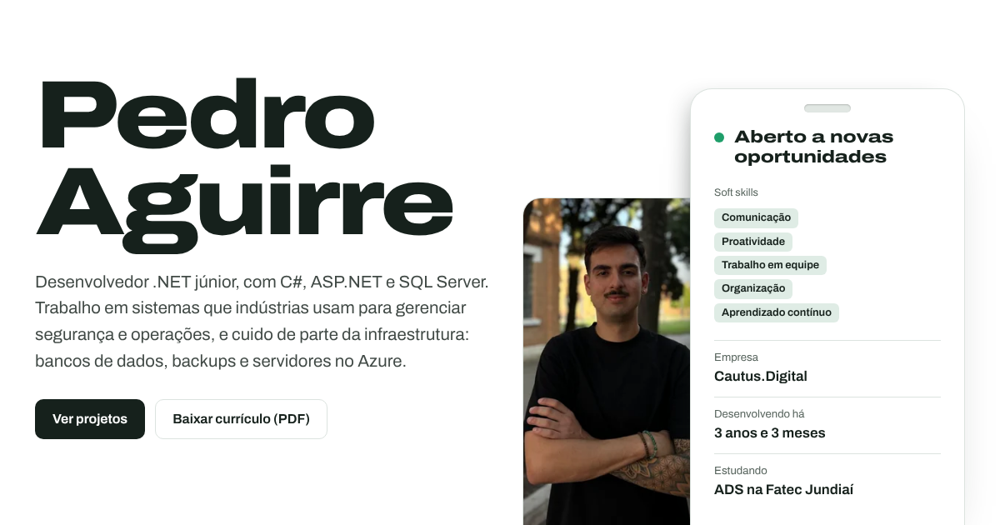

# Portfólio de Pedro Aguirre

Site pessoal que funciona como um currículo interativo para recrutadores: trajetória, experiência, projetos, habilidades, formação e contato, em **português e inglês**, com fundo branco e visual limpo.

Feito com **HTML, CSS e JavaScript puro**, sem frameworks, sem dependências e sem etapa de build. O HTML, o CSS e o JavaScript ficam em arquivos separados.

**Site no ar:** https://pedroaguirree.github.io *(depois de publicar, veja abaixo)*



## Funcionalidades

- **Foto interativa**: a foto do Pedro aparece num quadro ao lado do crachá. Ao passar o mouse na foto (ou tocar, no celular) aparece uma anotação em letra de mão com nome, idade e cidade, e uma seta apontando para ele.
- **Idade e tempo de experiência calculados sozinhos** a partir das datas no `CONFIG`.
- **Linha do tempo** da carreira, que vai sendo preenchida conforme a página rola.
- **Experiência em abas**: Desenvolvimento, Infraestrutura e bancos, e Microsoft Azure.
- **Galeria dos projetos** com troca de telas e imagem ampliada ao clicar.
- **Português e inglês** com um botão (a escolha fica salva no navegador).
- **Currículo em PDF** para baixar, em português ou inglês conforme o idioma da página.
- **Terminal escondido** no rodapé (atalho: tecla `` ` ``), com comandos como `ajuda`, `sobre` e `sudo contratar-pedro`.
- Funciona bem no celular, pode ser usado só pelo teclado e respeita quem prefere menos animação.

## Estrutura

```
Portfolio/
├── index.html                  # estrutura da página e textos em português
├── README.md                   # este arquivo
├── assets/
│   ├── css/
│   │   └── style.css           # todo o visual: cores, fontes, layout e versão para celular
│   ├── js/
│   │   └── main.js             # interações, textos em inglês, terminal e CONFIG
│   ├── img/
│   │   ├── favicon.svg         # ícone da aba do navegador
│   │   ├── claude-logo.svg     # (você adiciona) logo oficial do Claude, usado na seção de IA
│   │   ├── og.png              # imagem que aparece ao compartilhar o link
│   │   ├── pedro*.webp, pedro-alto*.webp   # foto do topo (computador e celular)
│   │   ├── peju-*.webp         # telas do PeJu Finanças (dados fictícios)
│   │   └── autonf-*.webp       # telas do AutoNF (dados fictícios)
│   └── cv/
│       ├── curriculo-pedro-aguirre.pdf   # currículo em português
│       └── resume-pedro-aguirre.pdf      # currículo em inglês
└── curriculo/                  # fonte dos currículos em PDF
    ├── curriculo.html          # currículo em português
    ├── resume.html             # currículo em inglês
    ├── cv.css                  # visual dos currículos
    └── gerar.py                # gera os PDFs em assets/cv/
```

## Como rodar no computador

Não precisa instalar nada: dê dois cliques no `index.html`.

Para ver exatamente como vai ficar no ar, rode um servidor local dentro da pasta e abra http://localhost:8000:

```
python -m http.server 8000
```

## Como personalizar

### Contato, nascimento e currículos

No começo de `assets/js/main.js`:

```js
const CONFIG = {
  whatsapp: "",            // DDI + DDD + número, só dígitos. Ex.: "5511999999999"
  linkedin: "",            // ex.: "https://www.linkedin.com/in/seu-perfil"
  nascimento: [1998, 10, 22],
  inicioDev: [2023, 8],    // mês em que começou como dev
  cv: { pt: "assets/cv/curriculo-pedro-aguirre.pdf", en: "assets/cv/resume-pedro-aguirre.pdf" },
};
```

Enquanto `whatsapp` e `linkedin` estiverem vazios, os botões ficam escondidos.

### Textos e tradução

- O **português** está direto no `index.html`.
- O **inglês** está no objeto `EN` do `assets/js/main.js`.
- Os dois se ligam pelo atributo `data-i18n`: o elemento `<p data-i18n="peju.p">` usa a tradução `"peju.p"`. Mudou o texto em português, mude também o inglês com a mesma chave.

### Anotação da foto

Ao passar o mouse na foto (ou tocar, no celular) aparece uma anotação em letra de mão com uma seta apontando para o Pedro, como no PeJu. O texto fica no bloco `<div class="nota">` do `index.html`. Há duas versões do desenho: `nota-pc` (texto embaixo, seta subindo até a foto) e `nota-cel` (texto em cima, seta descendo). Se mudar o texto, mude nas duas e na tradução `nota.l1`/`nota.l2` do `EN`.

Quando a página abre, a anotação aparece sozinha por 4 segundos para o visitante saber que ela existe. Para tirar isso, apague o trecho que começa com `tAuto = setTimeout` no `main.js`.

### Soft skills do crachá

Ficam no bloco `<div class="soft">` do `index.html`, logo abaixo do "Aberto a novas oportunidades". As traduções são `soft.1` a `soft.5` no `EN`. Prefira nomes curtos, para caberem no crachá.

### Logo do Claude na seção de IA

Salve o arquivo oficial do logo em `assets/img/` com o nome `claude-logo.svg` (ou `claude-logo.png`). Ele aparece sozinho ao lado do título "IA como ferramenta". Enquanto o arquivo não existir, a seção aparece só com o texto.

### Cores e fontes

No topo de `assets/css/style.css`:

- `:root` tem todas as cores (`--paper` é o fundo branco, `--ink` o texto, `--accent` o verde de destaque).
- As fontes são a Archivo (texto) e a Caveat (anotação da foto), carregadas do Google Fonts no `index.html`.

### Trocar a foto

São dois recortes da mesma foto, com o rosto um pouco à esquerda do centro, porque o lado direito fica atrás do crachá:

- Computador: `assets/img/pedro.webp` (300×444) e `pedro@2x.webp` (600×889).
- Celular: `assets/img/pedro-alto.webp` (220×440) e `pedro-alto@2x.webp` (440×880), um recorte mais alto.

### Currículo em PDF

Edite `curriculo/curriculo.html` e `curriculo/resume.html` e gere os PDFs de novo:

```
pip install playwright
python -m playwright install chromium
python curriculo/gerar.py
```

## Publicar no GitHub Pages (grátis)

1. No GitHub, crie um repositório **público** chamado exatamente `pedroaguirree.github.io`.
2. Dentro desta pasta, rode:
   ```
   git init
   git add .
   git commit -m "Primeira versão do portfólio"
   git branch -M main
   git remote add origin https://github.com/Pedroaguirree/pedroaguirree.github.io.git
   git push -u origin main
   ```
3. No repositório, abra **Settings > Pages**, escolha **Deploy from a branch**, branch `main`, pasta `/ (root)`, e salve.
4. Em um ou dois minutos o site estará em **https://pedroaguirree.github.io**.

Para atualizar depois: edite os arquivos e rode `git add .`, `git commit -m "o que mudou"` e `git push`.

Se usar outro nome de repositório (ex.: `portfolio`), o endereço vira `https://pedroaguirree.github.io/portfolio/`. Nesse caso, ajuste o `og:image` no `index.html` para o endereço novo.

**Domínio próprio (opcional):** compre um domínio (ex.: `pedroaguirre.dev`), coloque-o em **Settings > Pages > Custom domain** e siga as instruções de DNS do GitHub.

## Antes de divulgar

- [x] LinkedIn preenchido no `CONFIG` (o WhatsApp ficou vazio de propósito).
- [ ] Abrir o site no computador e no celular e testar os dois idiomas.
- [ ] Colar o link no WhatsApp ou no LinkedIn e conferir se aparece a imagem de prévia (`og.png`).
- [ ] Colocar o link no LinkedIn, no perfil do GitHub e no currículo.

## Tecnologias

HTML5, CSS3 (variáveis, grid, `color-mix`) e JavaScript sem bibliotecas. Fonte [Archivo](https://fonts.google.com/specimen/Archivo). Currículos gerados com [Playwright](https://playwright.dev/python/).

## Autor

**Pedro Aguirre**, desenvolvedor de software júnior em Jundiaí (SP).
[GitHub](https://github.com/Pedroaguirree) · pedro.aguirre687@gmail.com

Feito com a ajuda do Claude Code.
